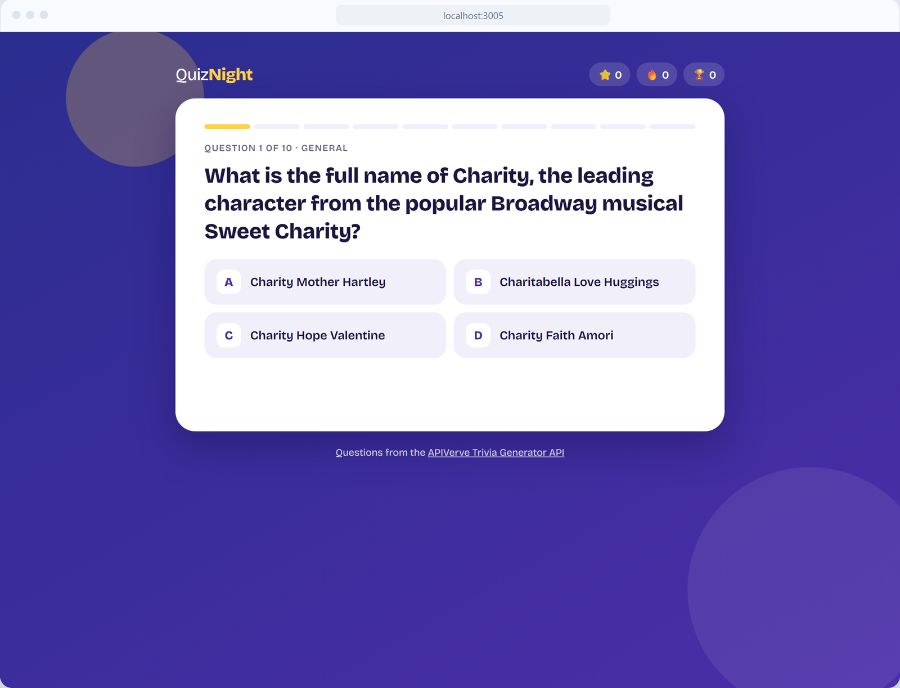

# Trivia Quiz | APIVerve Template

[](LICENSE)
[](package.json)
[](tsconfig.json)
[](https://apiverve.com/marketplace/trivia?utm_source=github&utm_medium=template&utm_campaign=trivia-quiz-nextjs-tutorial)

A trivia game you can deploy in one click. Play ten-question rounds of multiple-choice and true-or-false questions, see the right answer the moment you pick, and keep your score, streak and best round. The next question loads while you read the current one, so play never waits. It works on phones and desktops from the same code.

[](https://vercel.com/new/clone?repository-url=https%3A%2F%2Fgithub.com%2Fapiverve%2Ftrivia-quiz-nextjs-tutorial&project-name=trivia-quiz&repository-name=trivia-quiz&env=APIVERVE_API_KEY&envDescription=Your%20APIVerve%20API%20key.%20Free%20to%20create%2C%20no%20card%20needed.&envLink=https%3A%2F%2Fdashboard.apiverve.com%2Fsignup%3Fapi%3Dtrivia%26utm_source%3Dvercel%26utm_medium%3Dtemplate%26utm_campaign%3Dtrivia-quiz-nextjs-tutorial)



---

### Get your free API key

This template needs an APIVerve API key. **[Sign up free](https://dashboard.apiverve.com/signup?api=trivia&utm_source=github&utm_medium=template&utm_campaign=trivia-quiz-nextjs-tutorial)**, no credit card required.

---

## Deploy in one click

Click **Deploy with Vercel** above. Vercel copies this repo to your GitHub account, asks for your `APIVERVE_API_KEY`, and gives you a live URL about a minute later.

## Run it locally

```bash
git clone https://github.com/apiverve/trivia-quiz-nextjs-tutorial.git
cd trivia-quiz-nextjs-tutorial
npm install
cp .env.example .env   # then set APIVERVE_API_KEY in .env
npm run dev
```

Open `http://localhost:3000`. To see it in a phone and a browser frame side by side, open `http://localhost:3000/showcase.html`.

## How it works

1. `components/Quiz.tsx` is the game: the progress bar, the question, the answer buttons and the score. It calls `/api/question` for each question.
2. `app/api/question/route.ts` calls Trivia Generator and marks which option is right. Your API key stays on the server and never reaches the browser. Questions are never cached, since each one should be new, and every visitor is limited to 10 questions a minute.
3. The route strips the API’s A–D labels from the options and returns which one is right, so the page draws its own lettered buttons and marks the answer green or red. Your best round is kept in `localStorage`.

Everything here works on a free key: general-knowledge questions with their options and answer on every plan. Paid plans can also choose from 22 categories, such as science, history or movies, with the `category` parameter.

```
app/
  api/question/route.ts   the server route: calls the API and marks the right option
  layout.tsx              fonts and metadata
  page.tsx
  globals.css
components/
  Quiz.tsx                the game
lib/
  apiverve.ts             key, rate limit, cache and the API call
public/
  showcase.html           the phone and desktop demo frame
```

### The API call

```ts
const res = await fetch('https://api.apiverve.com/v1/trivia?category=general', {
  headers: { 'x-api-key': process.env.APIVERVE_API_KEY! }
});
const { data } = await res.json();
```

## Before you share your URL

Once deployed, anyone who finds your URL can use it on your API key. Each visitor can make 10 uncached requests a minute, and repeat lookups come from the cache, which is fine for a demo. Both are kept in memory, so they aren't shared between serverless instances. For production:

- Put the page behind your own sign-in, or
- Move the limit and cache to a shared store such as [Upstash Redis](https://upstash.com/), or
- Call the route only from your own backend.

## Ideas to extend it

- Add a fun fact after each answer with [Random Facts](https://apiverve.com/marketplace/randomfacts?utm_source=github&utm_medium=template&utm_campaign=trivia-quiz-nextjs-tutorial).
- Turn it into a party game with [Truth or Dare](https://apiverve.com/marketplace/truthordare?utm_source=github&utm_medium=template&utm_campaign=trivia-quiz-nextjs-tutorial).
- Play in another language with [Translator](https://apiverve.com/marketplace/translator?utm_source=github&utm_medium=template&utm_campaign=trivia-quiz-nextjs-tutorial).

## API reference

- [Trivia Generator](https://apiverve.com/marketplace/trivia?utm_source=github&utm_medium=template&utm_campaign=trivia-quiz-nextjs-tutorial): `GET https://api.apiverve.com/v1/trivia`
- [Full documentation](https://docs.apiverve.com?utm_source=github&utm_medium=template&utm_campaign=trivia-quiz-nextjs-tutorial)

## Tech stack

- **Next.js 16** (App Router) and **React 19**, in **TypeScript**
- A **Route Handler** in `app/api/` for the server side, so the key never reaches the browser
- Deploys to Vercel as-is, with no configuration

## License

MIT. See [LICENSE](LICENSE).
